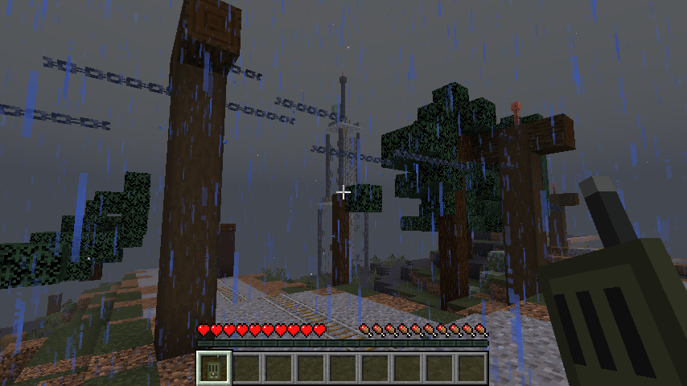

# SIGNAL

An original Minecraft Java Edition adventure built as a NeoForge mod. You are Elias Vale, a field systems
engineer restoring power and communication between isolated communities in the Meridian Corridor.

**Current state: M0 + M1 on NeoForge 1.21.1, with the Meridian Corridor world type.** One relay site
(Bellwether Relay Station 4) built into the terrain, with a real repair-and-allocation loop. See
[`docs/IMPLEMENTATION_STATUS.md`](docs/IMPLEMENTATION_STATUS.md) for exactly what works and what is planned.



| Requirement | Version |
| --- | --- |
| Minecraft Java Edition | **1.21.1** |
| NeoForge | **21.1.256** or newer 21.1.x |
| Java | **21** (64-bit JDK to build; the launcher's bundled Java 21 to play) |
| Other mods | none required. For the best graphics (Iris shaders, Distant Horizons) see [`docs/GRAPHICS.md`](docs/GRAPHICS.md) |

## Build (Linux)

From the project root:

```sh
java -version              # a JDK 21 must be installed (Gradle's toolchain uses Java 21)
./gradlew build            # compiles, runs the unit tests, produces the mod JAR
./gradlew runGameTestServer  # optional: boots a test server and runs the integration GameTests
```

The mod JAR is **`build/libs/signal-0.2.0.jar`**.

The first build downloads and decompiles Minecraft (several minutes, about 1–2 GB in `~/.gradle`).
Every command from the project root; `./gradlew runGameTestServer` builds the whole site on synthetic
terrain and plays the repair loop.
If Maven Central answers `429 Too Many Requests`, wait a minute and rerun; it is transient rate limiting.

Windows: the same tasks via `gradlew.bat build` etc. This was **not tested on Windows**.

### Development runs

```sh
./gradlew runClient        # dev client (uses ./run as the game directory)
./gradlew runServer        # dev dedicated server
./gradlew runClient -PquickPlayWorld=<folder in run/saves>   # open a world directly
```

## Install and play (a separate, clean instance)

Use a **separate** Minecraft instance so your normal worlds are untouched. Nothing in this project
installs itself anywhere.

1. In CurseForge: Minecraft → Create Custom Profile → **1.21.1**, loader **NeoForge**, version **21.1.256**
   or newer. (Any launcher works: install NeoForge 1.21.1 into a fresh game directory.)
2. Copy `build/libs/signal-0.2.0.jar` into that profile's `mods/` folder. In CurseForge the profile
   folder is shown by the profile's "Open Folder"; on Linux it is typically
   `~/Documents/curseforge/minecraft/Instances/<profile>/mods/`.
3. Launch and create a **new world**: **Allow Cheats: ON**, and **World Type: SIGNAL: Meridian Corridor**
   (More World Options / World tab). Minecraft will warn that the world uses *experimental settings*; that
   appears for any custom world type, choose "I know what I'm doing".
4. Stand anywhere on open ground and run:

   ```
   /signal scenario create bellwether
   ```

   The command surveys the land and builds the site into it, east of you (about 176 x 144 blocks): a
   road through the forest, an old rail line, the fenced compound, the relay tower on the high ground and
   the houses of Bellwether. It refuses if the area contains player-made things (builds, chests, signs,
   item frames...). You are moved to the start of the road in Adventure mode, with a handheld radio.

The command announces everything it changes: your game mode and spawn point, hostile mobs kept from
spawning naturally inside the site (no game rule is changed; wildlife still spawns), and rain in the Overworld.
**Installing the mod alone changes nothing in any world.**

## Playing the first site

Follow the road east through the trees, under the power line and over the old rail crossing, to the
compound gate. Nia, Bellwether's technician, talks to you over the radio. Then:

1. **Read the maintenance log** on the lectern by the door (optional; it explains the plant).
2. **Take a spare fuse** from the cabinet (barrel) marked *SPARE FUSES*.
3. **Open the distribution panel DP-1** (right-click). It shows the applied state on the left, your proposed
   breakers below it, and a plain-language preview on the right. Choose services: the generator gives
   **6 units**; the pump needs **5**, the local transmitter **1**, the regional relay **3**. Apply is refused
   for anything over 6.
4. **Fit fuse F1** from the panel. This only works while the supply is isolated, and uses exactly one fuse.
5. **Right-click generator G1** to close the isolator. (Sneak + right-click isolates it again.)
6. Watch the results: generator and service lamps light, the pump gauge and the header tank outside fill,
   machinery sounds start, and Nia confirms on the radio when the local transmitter is back.
7. Right-click the **handheld radio** (use it in the air) to replay the transcript.

The regional relay will take power but reach no one: its antenna was knocked off its bearing. The tower
north of the compound has a caged ladder to its top deck, where the slipped antenna mount waits for the
next milestone.

Operator commands: `/signal scenario status` prints the campaign state (including where the facility and
tower are); `/signal scenario reset bellwether` explains what a reset does, and
`/signal scenario reset bellwether confirm` rebuilds the service facility and starts a fresh timeline
(road, compound and tower stay; your inventory is not touched).

## Project layout

```
src/main/java/io/github/b1tr0n1n/signal/
  domain/     pure Java rules: bus, fuse, isolator, allocation preview, radio log, history (unit-tested)
  campaign/   SavedData persistence, server-side interaction validation, world projection, radio presentation, tick
  scenario/   terrain survey, path grading, site layout, prefabs (tower, houses...), occupancy guard
  network/    SimpleImpl channel: intentions client->server, snapshots server->client
  client/     panel screen (client-only, reached through DistExecutor)
  block/ item/ registry/ command/ gametest/
src/test/java/   JUnit domain tests
tools/           reproducible generators: textures, worldgen (biomes/world type), GameTest structures
docs/            status, decisions, compatibility pins, asset provenance, design summary, handoff
```

## Documents

- [Implementation status](docs/IMPLEMENTATION_STATUS.md) – what works, how it was verified, what is next
- [Graphics](docs/GRAPHICS.md) – Iris shaders, Distant Horizons, settings for the Meridian Corridor
- [Design summary](docs/DESIGN_SUMMARY.md) – and the full [handoff brief](docs/HANDOFF.md)
- [Decision log](docs/DECISIONS.md)
- [Compatibility pins](docs/COMPATIBILITY.md)
- [Asset provenance](docs/ASSET_PROVENANCE.md)
