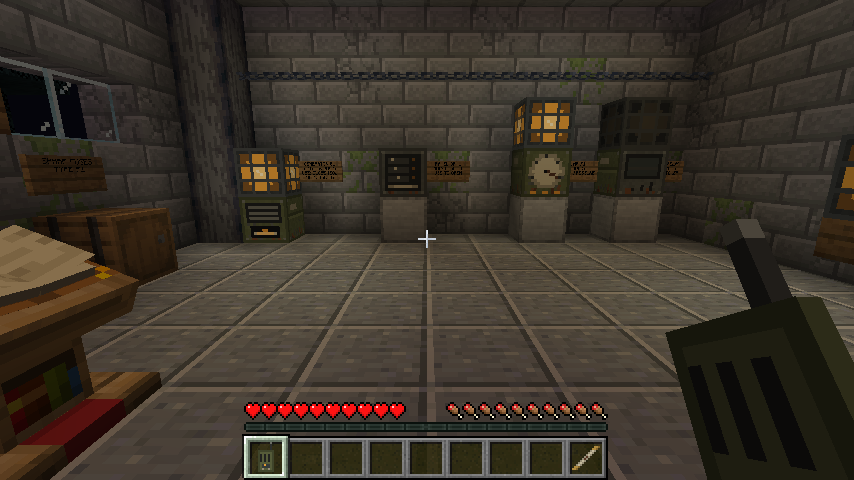

# SIGNAL

An original Minecraft Java Edition adventure built as a Forge mod. You are Elias Vale, a field systems
engineer restoring power and communication between isolated communities in the Meridian Corridor.

**Current state: milestones M0 and M1.** One walkable relay site (Bellwether Relay Station 4) with a
real repair-and-allocation loop. See [`docs/IMPLEMENTATION_STATUS.md`](docs/IMPLEMENTATION_STATUS.md)
for exactly what works and what is planned.



| Requirement | Version |
| --- | --- |
| Minecraft Java Edition | **1.20.1** |
| Forge | **47.4.10** (any 47.4.10 – 47.x works per `mods.toml`) |
| Java | **17** (64-bit JDK to build; the launcher's bundled Java 17 to play) |
| Other mods, shaders | none |

## Build (Linux)

From the project root:

```sh
java -version              # must report 17 for Gradle's toolchain; any JDK can launch Gradle
./gradlew build            # compiles, runs the unit tests, produces the mod JAR
./gradlew runGameTestServer  # optional: boots a test server and runs the integration GameTests
```

The mod JAR is **`build/libs/signal-0.1.0.jar`**.

The first build downloads and decompiles Minecraft (several minutes, about 1–2 GB in `~/.gradle`).
If Maven Central answers `429 Too Many Requests`, wait a minute and rerun; it is transient rate limiting.

Windows: the same tasks via `gradlew.bat build` etc. This was **not tested on Windows**.

### Development runs

```sh
./gradlew runClient        # dev client (uses ./run as the game directory)
./gradlew runServer        # dev dedicated server
./gradlew runClient -PquickPlayWorld=<folder in run/saves>   # open a world directly
```

## Install and play (a separate, clean instance)

Use a **separate** Minecraft instance so your normal worlds are untouched. Nothing in this project
installs itself anywhere.

1. In the official launcher (or any launcher), install **Forge 1.20.1 – 47.4.10** using the Forge installer
   from <https://files.minecraftforge.net/net/minecraftforge/forge/index_1.20.1.html>, into a new game directory.
2. Copy `build/libs/signal-0.1.0.jar` into that instance's `mods/` folder.
3. Launch and create a **new world** with **Allow Cheats: ON** (the command needs operator rights);
   **World Type: Superflat** is recommended so the site area is empty.
4. In that world run:

   ```
   /signal scenario create bellwether
   ```

   The site is built at your feet (48 x 28 blocks east/south of you, 3 below to 30 above). Creation is
   refused if the area contains anything that isn't natural terrain (blocks, chests, signs, item frames...).
   You will be moved to the start of the maintenance road in Adventure mode, with a handheld radio.

The command announces everything it changes: your game mode and spawn point, `doMobSpawning` set to
false (a server-wide game rule; revert with `/gamerule doMobSpawning true`), and rain in the Overworld.
**Installing the mod alone changes nothing in any world.**

## Playing the first site

Walk east along the road to the service yard and into the service room. Nia, Bellwether's technician,
talks to you over the radio. Then:

1. **Read the maintenance log** on the lectern by the door (optional; it explains the plant).
2. **Take a spare fuse** from the cabinet (barrel) marked *SPARE FUSES*.
3. **Open the distribution panel DP-1** (right-click). It shows the applied state on the left, your proposed
   breakers below it, and a plain-language preview on the right. Choose services: the generator gives
   **6 units**; the pump needs **5**, the local transmitter **1**, the regional relay **3**. Apply is refused
   for anything over 6.
4. **Fit fuse F1** from the panel. This only works while the supply is isolated, and uses exactly one fuse.
5. **Right-click generator G1** to close the isolator. (Sneak + right-click isolates it again.)
6. Watch the results: generator and service lamps light, the pump gauge and the header tank outside fill,
   machinery sounds start, and Nia confirms on the radio when the local transmitter is back.
7. Right-click the **handheld radio** (use it in the air) to replay the transcript.

The regional relay will take power but reach no one: its antenna was knocked off its bearing. Fixing that
is the next milestone.

Operator commands: `/signal scenario status` prints the campaign state; `/signal scenario reset bellwether`
explains what a reset does, and `/signal scenario reset bellwether confirm` rebuilds the site inside its
own bounds and starts a fresh timeline (your inventory is not touched).

## Project layout

```
src/main/java/io/github/b1tr0n1n/signal/
  domain/     pure Java rules: bus, fuse, isolator, allocation preview, radio log, history (unit-tested)
  campaign/   SavedData persistence, server-side interaction validation, world projection, radio presentation, tick
  scenario/   site builder, occupancy guard, create/reset service
  network/    SimpleImpl channel: intentions client->server, snapshots server->client
  client/     panel screen (client-only, reached through DistExecutor)
  block/ item/ registry/ command/ gametest/
src/test/java/   JUnit domain tests
tools/           reproducible generators for textures and empty GameTest structures
docs/            status, decisions, compatibility pins, asset provenance, design summary, handoff
```

## Documents

- [Implementation status](docs/IMPLEMENTATION_STATUS.md) – what works, how it was verified, what is next
- [Design summary](docs/DESIGN_SUMMARY.md) – and the full [handoff brief](docs/HANDOFF.md)
- [Decision log](docs/DECISIONS.md)
- [Compatibility pins](docs/COMPATIBILITY.md)
- [Asset provenance](docs/ASSET_PROVENANCE.md)
